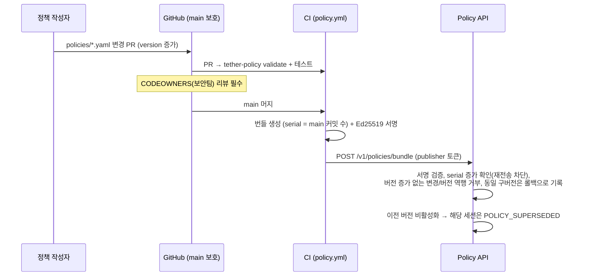
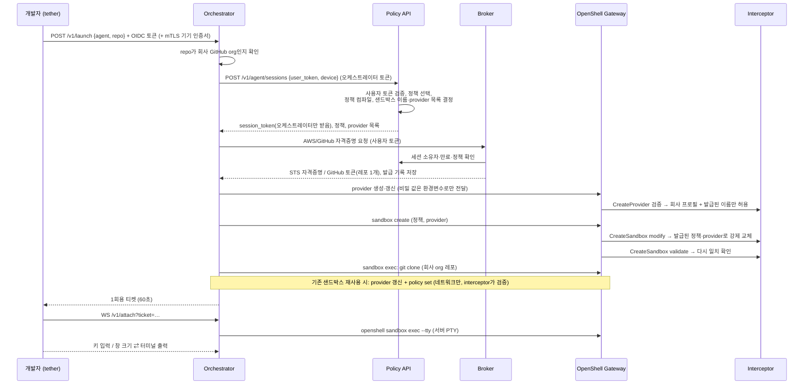
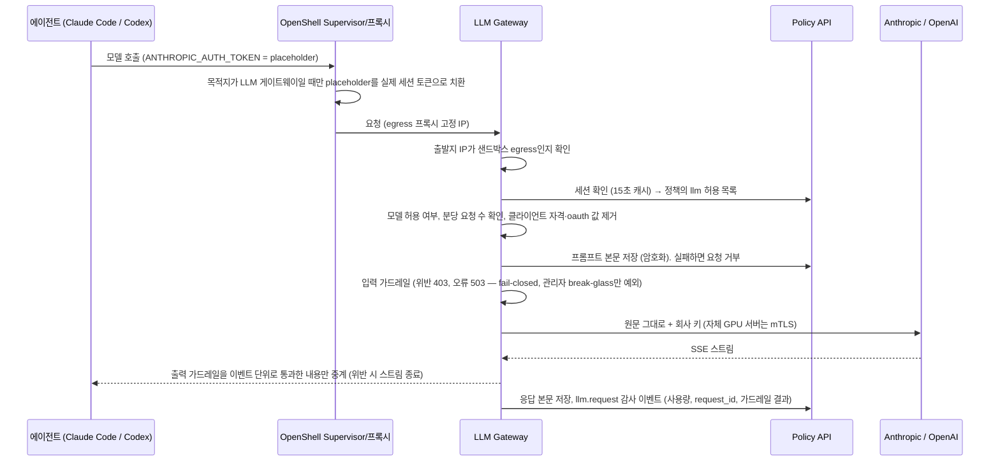
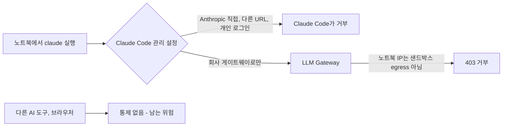
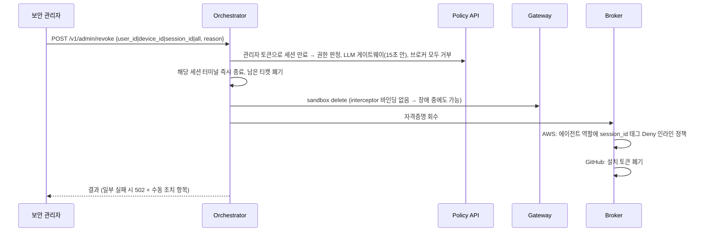

# Tether: 개발 현황 및 동작 개요

> 작성일: 2026-10-02
>
> **함께 볼 문서**
> - 상세 설계: [architecture.md](architecture.md)
> - 우회 경로 분석: [threat-model.md](threat-model.md)
> - 배포 할 일: [production-checklist.md](production-checklist.md)
> - 사고 대응: [incident-response.md](incident-response.md)
> - 로컬 LLM(GPU) 에이전트 관제 확장(제안): [adr/0001-local-llm-agent-control.md](adr/0001-local-llm-agent-control.md)

## 1. 목표와 보안 불변식

Claude Code와 Codex 같은 AI 코딩 에이전트를 회사 통제 안에서만 쓰게 하는 플랫폼입니다.

> **불변식:** AI 에이전트는 **관리형 샌드박스 안에서만**, **정책에 묶이고 회수 가능한 세션으로만** 모델, 회사 코드, 회사 자격증명에 접근할 수 있다.

설계 전제는 다음과 같습니다.
- 개발자가 Mac의 로컬 관리자(sudo)일 수 있다. 그래서 핵심 보장은 기기 쪽이 아니라 서버 쪽 통제 지점에 둔다.
- 샌드박스는 원격 관리형 OpenShell gateway에서 실행한다.
- GitHub는 Enterprise Cloud이다.
- Apple entitlement(Endpoint Security, Network Extension)는 받을 수 없다. 그래서 노트북 통제는 MDM으로 배포하는 Claude Code 관리 설정 하나뿐이다.
- 재택근무 때문에 노트북의 GitHub 접근은 막지 않는다.

**설계 원칙:** 실행 파일 이름이나 서명으로 막는 방식은 이름 변경, 직접 빌드, VM 실행으로 우회됩니다. 그래서 어떤 에이전트든 **반드시 지나가야 하는 지점**을 통제합니다.

| 통제 지점 | 내용 |
|---|---|
| 모델 접근 | LLM 게이트웨이가 유일한 경로입니다. 세션 토큰과 샌드박스 egress IP를 요구합니다. |
| 샌드박스 제어 | gateway 자격은 오케스트레이터만 가집니다. gateway interceptor가 Policy API를 기준으로 판정합니다. |
| 에이전트의 코드 접근 | 샌드박스에서는 GitHub org 경로만 허용하고(L7 규칙), 자격증명은 목적지에 묶습니다. |
| 자격증명 | 세션 범위의 단기 자격증명입니다. 킬 스위치 한 번으로 모두 회수합니다. |

---

## 2. 전체 구조

```text
 개발자 Mac                         컨트롤 플레인 (회사 서버)                         데이터 플레인 (관리형 OpenShell gateway)
┌──────────────────┐   launch    ┌──────────────────────┐  세션(사용자 토큰)   ┌────────────┐
│ tether    │────────────►│ Sandbox Orchestrator │────────────────────►│ Policy API │◄─── CI (서명된 정책 번들)
│ (터미널 클라이언트) │◄═══WS/PTY══►│ (gateway 자격 유일 보유) │  자격증명            └─────┬──────┘
└──────────────────┘             │                      │────────────────────►┌──────────────┐
┌──────────────────┐             │                      │                     │ Credential   │──► AWS STS / GitHub App
│ MDM 노트북 통제     │             │                      │  openshell CLI      │ Broker       │
│ Claude Code를      │             │                      │──────────────────┐  └──────────────┘
│ 회사 게이트웨이로 고정│             └──────────────────────┘                  ▼
└──────────────────┘
                                                              ┌─────────────────────────────┐   인가 조회   ┌─────────────────────┐
                                                              │ OpenShell Gateway            │◄────────────►│ Gateway Interceptor │──► Policy API
                                                              │  └─ Sandbox (Supervisor)     │  (fail-closed)└─────────────────────┘
                                                              │      egress 프록시(고정 IP)    │
                                                              └──────┬───────────┬──────────┘
                                                                     │           ├──► GitHub (회사 org 경로만)
                                                       세션 토큰       ▼           └──► 패키지 레지스트리 (read-only)
                                                       (placeholder) ┌────────────┐
                                                                     │ LLM Gateway│──► Anthropic / OpenAI (회사 키)
                                                                     └────────────┘
 감사 로그: 모든 구성요소 → Policy API (OCSF) → DB + stdout(JSON) → SIEM (pull API)
```

---

## 3. 구성요소

| 구성요소 | 경로 | 역할 | 상태 |
|---|---|---|---|
| **런처** | `agent-launcher/` | OIDC 로그인(device flow), 실행 요청, WebSocket 터미널. MDM 관리 설정 우선. macOS 서명/패키징 스크립트 | 구현, 테스트 17 |
| **Policy API** | `services/policy-api/` | 아래 표 참고 | 구현, 테스트 163 |
| **정책 컴파일러** | `services/policy-compiler/` | 회사 정책을 OpenShell 정책으로 변환, 검증, 번들 서명(Ed25519) CLI | 구현, 테스트 87 |
| **샌드박스 오케스트레이터** | `services/sandbox-orchestrator/` | gateway 자격 유일 보유. 세션, 자격증명, provider, 샌드박스 생성, 레포 클론, 터미널 중계, 킬 스위치. 관리자가 승인한 로컬 에이전트 job 실행(사람·스케줄), 지시문은 파일로 전달 | 구현, 테스트 27 |
| **Gateway Interceptor** | `services/gateway-interceptor/` | OpenShell gRPC 확장. 발급된 이름과 정책만 허용, 정책 확대와 우회 경로 차단, 회사 프로필 공급 | 구현, 테스트 61 |
| **LLM 게이트웨이** | `services/llm-gateway/` | 모델로 가는 유일한 경로. 세션 토큰 + egress IP 확인, 회사 키 사용, 모델 허용 목록, 사용량 감사. 자체 GPU 추론 서버(`local`, mTLS), 가드레일(fail-closed, break-glass), 프롬프트·응답 본문 감사 ([ADR 0001](adr/0001-local-llm-agent-control.md)) | 구현, 테스트 74 |
| **Credential Broker** | `services/credential-broker/` | STS(SourceIdentity, 세션 태그), GitHub App 토큰(레포 1개), 발급 기록(암호화), 회수 | 구현, 테스트 28 |
| **Permission MCP** | `services/permission-mcp/` | 샌드박스 안 에이전트용 권한 질의 도구(세션 토큰 기반) | 구현 |
| **로컬 에이전트** | `local-agent/`, `infra/sandbox-images/local-agent/` | job 샌드박스에서 도는 OpenAI 호환 도구 호출 루프(파일·셸 도구, 작업 디렉터리 밖 접근 거부). 단일 실행 파일과 샌드박스 이미지 | 구현, 테스트 22 |
| **GPU 네트워크·SSH 강제** | `infra/gpu/network/` | 단일 설정에서 nftables, envoy mTLS 프록시, K8s NetworkPolicy, sshd/bastion 설정 생성. 양방향 검증 도구(`verify.py`) | 구현, 테스트 71 |
| **가중치·이미지 서명** | `infra/gpu/signing/` | 가중치 매니페스트 Ed25519 서명·검증(safetensors만), cosign 이미지 검증, systemd `ExecStartPre`·policy-controller | 구현, 테스트 41 |
| **노트북 통제 (MDM)** | `infra/mdm/` | Claude Code 관리 설정(회사 게이트웨이 고정) 생성기. 노트북용 MDM 프로필과 파일, 샌드박스 이미지용 파일. Apple entitlement 불필요 | 구현, 테스트 6 |
| **정책 원본 (GitOps)** | `policies/`, `.github/` | 정책 YAML, CI(검증 → 서명 → 게시), CODEOWNERS | 구현 |
| **OpenShell 설정** | `openshell/profiles/`, `infra/openshell/` | 목적지에 묶인 provider 프로필 3종, gateway interceptor TOML | 작성 |
| **GitHub 동기화** | `infra/github/` | Enterprise Cloud IP allow list 동기화. 노트북 GitHub 접근을 막지 않기로 해서 지금은 쓰지 않음(보관) | 구현, 테스트 7 |
| **로컬 스택** | `infra/docker-compose.yml` | postgres와 서비스 6개(개발 모드) | 동작 확인 |

**Policy API가 하는 일**
- OIDC 인증, 세션 생성(오케스트레이터 전용), 권한 판정
- 정책 번들 게시, 정책 선택, 감사 로그(OCSF)
- 킬 스위치, SIEM용 조회 API
- interceptor와 LLM 게이트웨이용 조회 API, Alembic 마이그레이션 9개(0005에서 기기 테이블 삭제)
- 프롬프트·응답 본문 보존(`CONTENT_RETENTION_DAYS`, 기본 90일)과 파기(`python -m app.purge`), 법적 보존(hold)

**노트북 통제(MDM)가 하는 일**
- Claude Code가 회사 LLM 게이트웨이 외에는 연결하지 못하게 고정합니다. 게이트웨이는 샌드박스에서 온 요청만 받으므로, 노트북의 Claude Code는 개인 로그인을 포함해 동작하지 않습니다.
- Claude Code에만 적용되고, 관리자 권한이 있으면 지울 수 있는 억제 수단입니다. 핵심 보장은 이것에 의존하지 않습니다.

---

## 4. 구현 단계

| 단계 | 주요 내용 |
|---|---|
| **P0: PoC 버그 정리** | 정책 변환을 컴파일러 한 곳으로 일원화. 샌드박스 이름을 고정 규칙(user + repo + 정책 해시)으로. 권한 판정 기본 거부. 입력 정제. ES의 AUTH_EXEC 응답 처리. 경로 정규화 버그(`//`) 수정. 네트워크 판정 오류 수정. compose 기동 순서 수정. |
| **P1: 신원과 자격증명** | OIDC JWT 검증, mTLS 기기 신원, 세션 토큰(해시 저장), Credential Broker(STS, GitHub App), 감사 로그 OCSF 정규화. OpenShell provider로 자격증명 전달(에이전트에게는 placeholder만 보임). |
| **P2: 정책 관리** | Alembic 도입. GitOps 정책(서명 번들, serial로 재전송 차단, 버전 증가 강제, 감사되는 롤백). 레포·환경·그룹별 정책 선택. 네트워크 정책 실시간 반영(정적 섹션만 샌드박스 이름에 반영). |
| **P3: 호스트 강제와 운영** | (Endpoint Security 확장은 이후 제거) 런처 관리 설정과 빌드. 킬 스위치. SIEM 조회 API. 사고 대응 런북. |
| **우회 경로 제거** | 원격 샌드박스 전환(오케스트레이터, 터미널 중계). LLM 게이트웨이. 오케스트레이터만 세션 생성. GitHub org 경로 제한과 레지스트리 read-only. 모델 host 직접 허용 금지. 자격증명 목적지 묶기. 킬 스위치 완성(STS 거부, GitHub 토큰 폐기). GitHub IP allow list 동기화. |
| **Gateway Interceptor** | 발급된 이름과 정책만 허용하고, 정책과 provider를 강제로 교체. 확대와 우회 경로(Attach, 초안 승인, SSH, 서비스 노출, 프로필 변경) 차단. 회사 프로필 공급. gateway JWT 검증. 삭제 계열은 바인딩하지 않음. |
| **Apple 의존 제거, MDM 통제** | Endpoint Security와 Network Extension 확장, 기기 heartbeat를 제거(마이그레이션 0005). 런처는 Developer ID 없이 빌드. Claude Code 관리 설정(노트북·샌드박스) 생성기 추가. DNS 차단은 검토 후 제외. 노트북 GitHub 접근은 막지 않기로 결정. |

---

## 5. 전체 동작 플로우

### 5.1 정책 배포 (GitOps)



### 5.2 에이전트 실행



### 5.3 샌드박스 안에서 에이전트가 동작할 때



에이전트의 다른 접근도 같은 방식으로 통제됩니다.

| 접근 대상 | 통제 |
|---|---|
| GitHub | `/<org>/**` 경로만 허용(L7 규칙). GitHub 토큰 placeholder도 이 경로에서만 치환됩니다. |
| 패키지 레지스트리 | GET/HEAD/OPTIONS만 허용합니다. 업로드는 불가합니다. |
| 그 외 host | 정책에 없으면 차단합니다. 모델 제공자 host는 정책에 넣을 수 없습니다(컴파일러가 거부). |
| 파일시스템, 프로세스 | Landlock 필수, root가 아닌 `sandbox` 사용자로 실행합니다. |
| 권한 질의 | Permission MCP가 세션 토큰으로 Policy API에 묻습니다. 신원은 서버에 저장된 세션 기준입니다. |

### 5.4 노트북 (MDM 통제)



### 5.5 킬 스위치 (사고 대응)



### 5.6 감사 로그

| 이벤트 | 기록 주체 |
|---|---|
| `session.create`, `permission.check`, `policy.publish`, `session.revoke` | Policy API |
| `sandbox.create`, `sandbox.reuse`, `agent.exit`, `sandbox.delete` | Orchestrator |
| `credential.issue` | Broker |
| `llm.request`, `guardrail.block`, `guardrail.error` | LLM Gateway |
| `llm.content`, `audit.content.read`, `guardrail.bypass.start`, `guardrail.bypass.end` | Policy API |

위 이벤트는 모두 OCSF 형식으로 저장되고, stdout JSON과 `GET /v1/audit/events`(SIEM 조회)로 수집할 수 있습니다. actor는 항상 서버가 인증한 신원에서 정합니다. 사용자는 이벤트를 보고할 수 없습니다.

---

## 6. 우회 경로와 통제 요약

| 우회 시도 | 통제 |
|---|---|
| `openshell`을 직접 실행해 약한 정책의 샌드박스 생성 | 원격 gateway(사용자 자격 없음) + interceptor |
| 로컬 VM이나 컨테이너, 자체 스크립트로 에이전트 실행 | 회사 모델 접근 불가(세션 토큰이 Mac에 없음). 개인 모델 사용은 막지 않음 |
| 개인 claude.ai 로그인이나 개인 API 키 | LLM 게이트웨이가 거부 + 노트북의 Claude Code 관리 설정 |
| 관리되지 않는 기기로 클론 | 막지 않음(재택근무). 회사 SSO와 GitHub 권한만 적용 |
| 다른 레포로 push, 레지스트리 업로드, 자격증명을 다른 host로 전송 | org 경로 L7 규칙, read-only, 목적지 묶기 |
| 오케스트레이터 자격 유출 후 샌드박스 생성이나 확대 | Interceptor(Policy API 기준, fail-closed) |
| 정책 변조나 재전송 | 서명 번들, serial, 버전 검사, CODEOWNERS |
| 회수 후에도 자격증명 사용 | 킬 스위치(STS Deny, 토큰 폐기, 샌드박스 삭제) |

**남는 위험** (자세한 내용은 [threat-model.md](threat-model.md))
1. **노트북과 다른 기기의 회사 코드:** 재택근무를 위해 노트북의 GitHub 접근을 막지 않습니다. 개발자가 받을 수 있는 코드는 플랫폼 밖 도구로 옮겨질 수 있으며, 이는 DLP와 사용 정책의 영역입니다.
2. **노트북의 개인 AI:** 호스트 수준 차단이 없습니다. Claude Code 관리 설정은 Claude Code에만 적용되고(Codex, IDE 어시스턴트, 브라우저는 해당 없음), 관리자 권한으로 지울 수 있습니다. 회사 EDR이나 SWG가 생기면 보강할 수 있습니다.
3. **유출된 gateway 자격으로 exec:** 기존 샌드박스에 셸로 들어가는 것은 막을 수 없습니다(OpenShell 스트리밍 RPC는 가로챌 수 없음). 그 샌드박스도 발급된 정책 안에 갇혀 있습니다.
4. **목록에 없는 모델 host:** 새로운 모델 host나 자체 호스팅 엔드포인트는 목록을 갱신해야 차단됩니다.

---

## 7. 검증 현황

| 구분 | 내용 |
|---|---|
| 단위·통합 테스트 | `make test`: Python 604개(컴파일러 87, Policy API 163, Broker 28, LLM Gateway 74, Orchestrator 27, Interceptor 61, GitHub 동기화 7, 런처 17, MDM 생성기 6, 로컬 에이전트 22, GPU 네트워크 71, 서명 41) |
| 실제 프로세스 E2E | 실제 TTY 런처 → WebSocket → 서버 PTY → (가짜) OpenShell exec, 입력 중계와 종료 코드 |
| 컨테이너 E2E | 마이그레이션(기존 볼륨, 0001→0005), 오케스트레이터 전용 세션, LLM 게이트웨이(개인 토큰과 미허용 모델 거부, Anthropic까지 중계), interceptor gRPC 공격 시나리오, 킬 스위치, SIEM 조회 |
| GPU 경계 E2E | Docker에서 생성한 envoy 설정과 nftables 적용 후 `verify.py`: 샌드박스 쪽 6/6, gateway 쪽 9/9 통과. `sshd -T`로 GPU 호스트·bastion 설정 확인 |
| 빌드 | 로컬 에이전트 이미지(arm64)와 가짜 gateway 대상 실행, Docker 이미지 6종, 런처 PyInstaller(ad-hoc 서명)와 pkg, MDM 프로필 형식 검사(`plutil`) |

**검증하지 못한 부분** (실제 환경이 필요함)
- OpenShell gateway와 CLI 실제 연동: provider, policy set, exec, interceptor 정규화 동작, 프로필 문법 검사(`profile lint`), github-org 프로필에서의 git 인증 방식
- MDM: 실제 Mac에 Claude Code 프로필 적용, Claude Code `/status` 확인
- 실제 IdP, AWS STS와 IAM, GitHub App
- GitHub Actions 정책 파이프라인
- GPU 서버: 실제 호스트의 nftables·tlog·auditd, 실제 cosign과 policy-controller, `openshell sandbox exec`의 stdin 전달(로컬 에이전트 지시문 파일)

---

## 8. 남은 작업 (요약)

전체 목록은 [production-checklist.md](production-checklist.md)에 있습니다.

- **인프라:** 원격 OpenShell gateway(K8s), 고정 IP egress 프록시, mTLS 프록시와 기기 인증서, interceptor TLS와 gateway 공개키, SIEM 연동
- **자리표시자 교체:** `your-org`, 내부 호스트명, `infra/mdm/config.yaml`(게이트웨이 URL, 프로필 접두사)
- **새로 만들 것:**
  - `tether-aws` 프로필(SigV4 재서명). 그 전까지 AWS 권한은 차단 쪽으로 동작합니다.
  - 샌드박스 이미지: Claude Code 관리 설정(`allowedProviders: ["customEndpoint"]`), Codex 게이트웨이 설정, git 인증 설정
- **MDM:** 시범 Mac 검증 후 Claude Code 프로필과 런처 pkg 배포
- **GitHub:** 브랜치 보호, CODEOWNERS 팀 지정, CI 시크릿, GitHub App 생성과 설치
- **Staging:** 단일 GPU 서버 구성 절차는 [infra/staging/README.md](../infra/staging/README.md)
- **GPU 서버:** `infra/gpu/network/config.yaml`의 실제 주소와 PKI, 서명 키 생성(키 세레모니), 본문 파기 CronJob 배포
- **오케스트레이터 다중 인스턴스:** 지금은 티켓과 터미널 상태를 메모리에 두므로 인스턴스를 하나만 띄워야 합니다.

---

## 9. 로컬 실행

```bash
make test                              # 전체 테스트 (proto 코드 생성 포함)
make mdm                               # 노트북·샌드박스 Claude Code 관리 설정 생성
make up                                # postgres + 서비스 6개 (AUTH_MODE=dev). 처음 실행하면 infra/.env에 개발용 암호화 키를 새로 만듦

make launcher
export TETHER_TOKEN=dev:$USER TETHER_ORCHESTRATOR=http://localhost:8083
tether claude                   # 회사 org 레포 안에서 실행 (오케스트레이터에 OpenShell CLI와 gateway 자격 필요)
```

| 포트 | 서비스 |
|---|---|
| 8080 | Policy API |
| 8081 | Broker |
| 8082 | LLM Gateway |
| 8083 | Orchestrator |
| 18081 | Interceptor |
